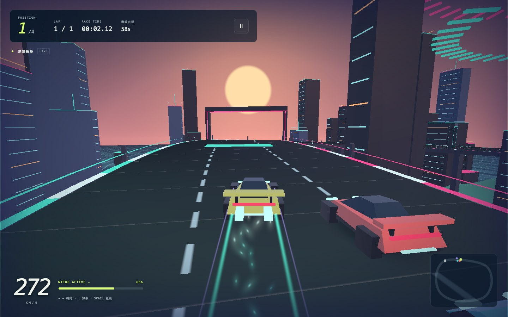
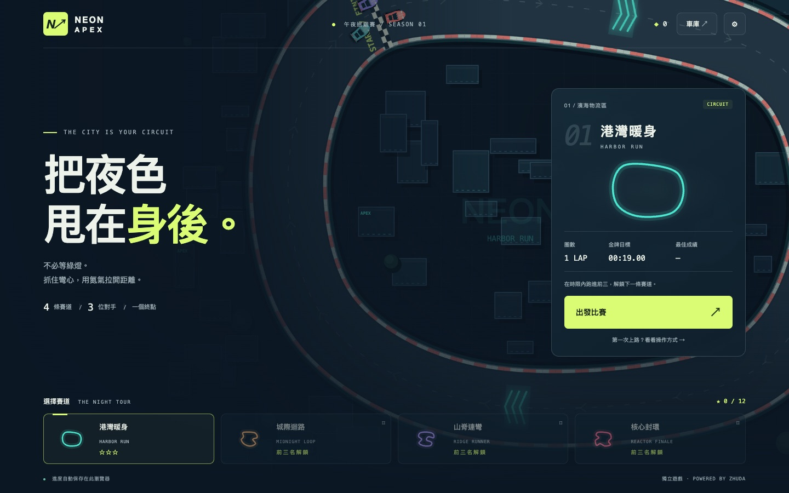
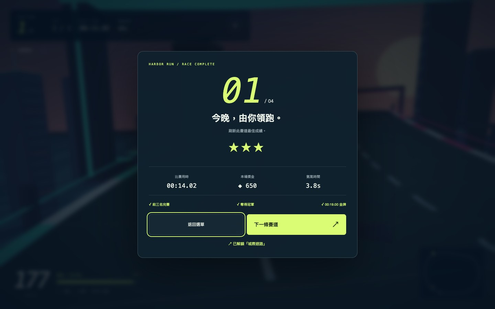

# 霓虹疾線 · NEON APEX

免費瀏覽器賽車遊戲。抓住彎心，用氮氣超車，從港灣一路跑進能源核心。

**[立即遊玩 ↗](https://zhudaandzhuer.github.io/zhuda-neon-racer/)**



四條逐步解鎖的賽道、三名電腦對手、限時比賽與勝負結算。跑進前三名獲得獎金並解鎖下一關；冠軍、金牌時間各增加一顆星。獎金可升級動力、抓地與氮氣，累積星星能解鎖不同操控特性的車款。

進度自動儲存在目前的瀏覽器，設定內可匯出／匯入 JSON 備份。沒有帳號、後端、追蹤服務或付費項目。

## 操作

| 動作 | 鍵盤 | 手機 |
| --- | --- | --- |
| 轉向 | ← → / A D | 左右轉向鍵 |
| 煞車／漂移充能 | ↓ / S，同時轉向可漂移 | 煞車，同時轉向 |
| 氮氣 | 按住 SPACE / Shift | 按住 N₂ |
| 暫停 | ESC / P | 右上暫停鍵 |
| 油門 | 預設自動；關閉後使用 ↑ / W | 預設自動；關閉後顯示油門鍵 |

入彎前減速，出彎後再用氮氣。發光箭頭帶能補充氮氣。手機可同時按住轉向與氮氣，橫向握持視野更寬。



## 獨立於引擎

這個倉庫擁有賽道、賽車物理、對手、關卡、UI、存檔、音效與美術。它使用 [zhuda-laya-engine](https://github.com/zhudaandzhuer/zhuda-laya-engine) 的公開 SDK 與 LayaAir 3.4.2 WebGL 2D 執行環境。氮氣粒子、漂移煙霧、碰撞火花與歷史尾流由引擎模擬／渲染。

引擎倉庫不包含本遊戲。CI 固定引擎版本 `0ec1d3717756544467ab065ef23062f0755ef2c5`，不追蹤浮動的 main。

## 本機開發

Node.js 24+，引擎與遊戲放在相鄰資料夾：

```sh
git clone https://github.com/zhudaandzhuer/zhuda-laya-engine.git Zhuda-LayaAir
git -C Zhuda-LayaAir checkout 0ec1d3717756544467ab065ef23062f0755ef2c5
cd Zhuda-LayaAir
npm install
npm run build
cd ..
git clone https://github.com/zhudaandzhuer/zhuda-neon-racer.git Zhuda-NeonRacer
cd Zhuda-NeonRacer
npm run build
PORT=8907 npm start
```

開啟 `http://localhost:8907/`。非相鄰資料夾可指定 `ZHUDA_ENGINE_ROOT`。產出的 `dist/` 可直接放到任何靜態網站，無需執行中的開發伺服器或引擎倉庫。

## 驗證

```sh
npm run typecheck
npm test
npm run verify:browser
```

瀏覽器測試需要 Chrome；Linux 可設 `CHROME_PATH=/usr/bin/google-chrome`。可用 `GAME_URL` 對已發布的網址執行同一套測試，使用隔離的臨時瀏覽器與存檔。

- 模型測試：四關皆以駕駛輸入跑完，檢查八區段圈數、勝負、獎金只發一次、禁止逆行／跳過檢查點、護欄、氮氣、升級與壞存檔恢復。
- WebGL 整合測試：完整即時比賽、實際鍵盤輸入、氮氣粒子／歷史尾流、暫停、購買、重載保存、檔案備份與還原、雙指觸控、390×844 與 844×390 排版、四關場景、超時結算邊界。
- [驗證紀錄](docs/browser-verification.json)。瀏覽器中的完整比賽使用測試駕駛；響應式測試不等同所有手機的效能認證。音效由 Web Audio 合成，仍需使用者互動才能解鎖播放。
- [正式站回歸紀錄](docs/production-verification.json)：對 GitHub Pages 正式網址執行同一套完整驗證，包含實際完賽與存檔還原。



## 授權

MIT。所有賽道、車輛圖形、粒子貼圖與音效由本專案程式生成，不載入第三方美術或音樂。引擎與 LayaAir 授權見 [THIRD_PARTY_NOTICES.md](THIRD_PARTY_NOTICES.md)。
