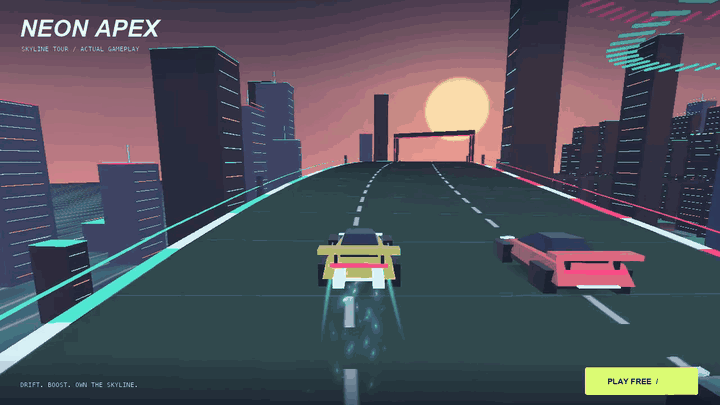

# NEON APEX · Skyline Tour

**Drift. Boost. Own the skyline.** A free 3D browser racer: elevated city circuits, sunset ocean, neon rivals and world-space nitro trails.

**[PLAY NOW →](https://zhudaandzhuer.github.io/zhuda-neon-racer/)** · [Watch the gameplay film](https://zhudaandzhuer.github.io/zhuda-neon-racer/showcase.html)

[](https://zhudaandzhuer.github.io/zhuda-neon-racer/)

Four circuits, three AI rivals, time limits and a garage. Finish in the top three to unlock the next circuit. Wins earn credits for power, grip and nitro upgrades; stars unlock different cars. Progress saves in your browser and can be exported/imported as JSON.

The new 3D renderer preserves the original driving, checkpoints, rewards and existing saves. There is no account, payment or tracking service.

| Action | Keyboard | Touch |
| --- | --- | --- |
| Steer | ← → / A D | Left / right buttons |
| Brake / drift charge | ↓ / S while steering | Brake + steer |
| Nitro | Hold Space / Shift | Hold N₂ |
| Pause | Esc / P | Pause button |
| Throttle | Automatic by default; ↑ / W in manual mode | Throttle button in manual mode |

Brake into the corner and boost on exit. Luminous energy strips replenish nitro. Touch supports steering and nitro together; landscape gives a wider view.


## Rendering and engine boundary

This repository owns the game: race simulation, circuits, cars, procedural skyline, UI, save data, audio and media. It consumes the public [zhuda-laya-engine](https://github.com/zhudaandzhuer/zhuda-laya-engine) SDK and LayaAir 3.4.2 WebGL 3D runtime. It includes:

- A real 3D chase camera, sculpted cars, elevated track geometry and a material-batched skyline.
- Shader-driven sunset, water and road surfaces; closed heightfield islands.
- Engine 3D particles, historical ribbons and camera boom collision probes.
- Desktop bloom, disabled on coarse-pointer devices; reduced effects preserve driving rules.

The film is an actual canvas capture at 1280 × 720 / 60 FPS with a test driver. The README GIF is a smaller 16 FPS preview. A short desktop capture is not a certification of mobile performance.

## Develop

Node.js 24+. Put the engine and game in adjacent folders, or set `ZHUDA_ENGINE_ROOT` to the engine checkout. CI pins SDK revision `bdfdf51c46346868138d977aa8432ae8f7c9f828` in `.github/workflows/pages.yml`.

```sh
# In the engine checkout first:
npm install
npm run build
# In this game checkout:
npm run typecheck
npm run build
npm test
npm run verify:browser
PORT=8907 npm start
```

Open `http://localhost:8907/`. The generated `dist/` is a standalone static site. Live browser tests need Chrome; set `CHROME_PATH` on Linux. `GAME_URL` runs the same checks against a deployment.

[Browser verification](docs/browser-verification.json) covers an actual completed race, keyboard/nitro, pause, unlocks, purchases, reload, save backup/restore, simultaneous touch input, portrait/landscape, timeout and all four scenes. Twelve successive scene switches return the resource count to the same bounded total. The rule suite drives all four circuits to completion without teleporting.

## License

MIT. Cars, circuits, skyline, textures and sound are generated by this project. The launch screen includes the existing Zhuda / LayaAir community artwork; this game is independently maintained. See [THIRD_PARTY_NOTICES.md](THIRD_PARTY_NOTICES.md) for engine/upstream licensing.
