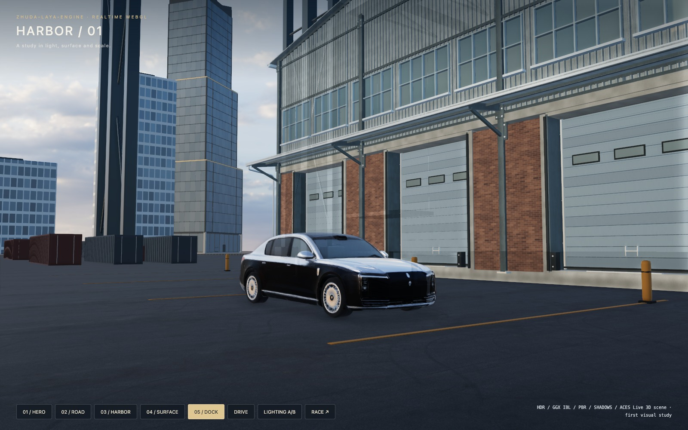
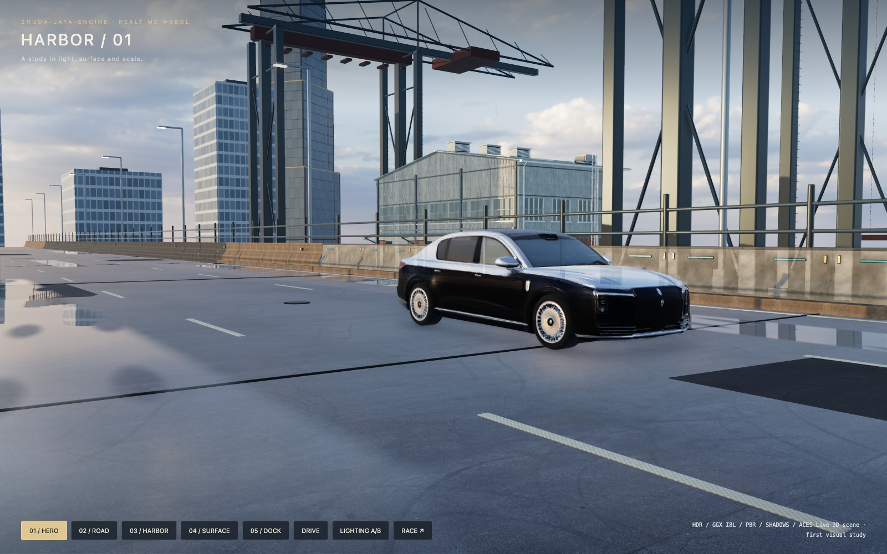

# HARBOR / 01 — first quality slice

[Open the live study](https://zhudaandzhuer.github.io/zhuda-neon-racer/visual.html).

The goal is a believable, controllable Web 3D scene with an eventual AAA visual feel. This first slice prioritizes visual capability over device budgets. It is separate from the stable race entry and preserves its driving rules and saves. DRIVE in this study moves the vehicle and camera through the scene; it is not a completed new race mode.

## Delivered baseline

- A 240 m physically sized harbor bridge, shoulders, joints, railings, drainage grates, access covers, resurfaced repairs, cranes, warehouses, quay and water. Containers and warehouses meet their paved support surfaces.
- Real CC0 4K pure-sky HDR, matching sky orientation and direct shadow light, 256px nine-mip offline GGX specular convolution and diffuse SH9.
- 2K photographed asphalt/concrete maps with explicit sRGB/data handling, UV-derived tangent frames and OpenGL normal convention in color/depth-normal passes.
- Native PBR surface hooks for wetness, tire wear, paint and window grids; real 1280×800 half-float planar pool reflections.
- 4096 soft cascaded shadows, HDR, high-quality AO, restrained bloom, ACES and TAA with camera-cut reset.
- A separate 319,998-triangle S800 with original 4K PBR maps. The generated normal strength is reduced to .25 in this scene. The original source is retained; this is a static reconstruction with no independent wheel rig.
- Imported authored hard-surface tower, near-field barrier and three-bay dock warehouse models, replacing uneven AI candidates. Source dimensions, validation, material inventories and hashes are in `public/visual-assets/scenery.json`. The warehouse retains its full 372,884 triangles and all original normals, tangents, UVs and PNG maps; [its source scripts](../source-assets/dock_warehouse/README.md) are included. All are static assets; the rest of the scenery is authored in this consumer.

`public/visual-assets/sources.json` records CC0 source URLs, bytes and SHA-256. The reproducible Blender/NumPy script `scripts/prepare-visual.py` creates the convolved light and packed native material maps. `scripts/prepare-model.py` creates the separate hero vehicle without modifying the original. The engine repository contains no game art.

## Acceptance and evidence

Run `node tests/visual.mjs` after typecheck/build. It uses a clean Chrome profile and repository subpath, captures five views and saves `evidence/visual-verification.json` plus screenshots. Checks include actual GPU cube-face readback, PBR bindings, motion, reflection pose/target contribution, shadow-only differences, lighting A/B outside the UI and 30 drawn pipeline replacements. Estimated resource memory is labeled as an estimate, not measured GPU usage. This quality study has no mobile performance acceptance claim.

Local capture uses a 1600 × 1000 viewport; software-rendered CI uses 1024 × 768 with the same scene assets, shader pipeline, reflection target and shadow settings. The report records the viewport. Each check logs progress, and transport timeouts/renderer crashes fail explicitly.

The complete 10-check suite also passed locally using SwiftShader software rendering at the CI viewport, including all 30 full-scene pipeline replacements with unchanged resource totals. The first bounded cloud run passed all nine visual checks and reached replacement 5/30 before its 20-minute job budget expired. The job budget is now 40 minutes; this is a correctness run without a frame-rate acceptance target.

Rendering tests establish that the features are active and consistent. Screenshot review remains a separate art gate: the current scene still has generic distant architecture, limited prop storytelling and reconstructed car surfaces. The near-field warehouse is authored geometry with recessed doors, canopy, skylights, pipes and ladders; it is reviewed in the actual game lighting. It is not accepted as final AAA quality and does not claim Unreal, Lumen or Nanite parity.

### Accepted rendering evidence

The [10-check real WebGL report](visual-verification.json) passed on 2026-10-30. It verifies all six cube axes plus fractional mip interpolation, actual material/4K glTF normal bindings, five settled camera views, the warehouse's rotated metre bounds and support contact, drive/stop behavior, reflection/shadow/lighting pixel changes and 30 drawn pipeline replacements. Changing the car normal strength from .25 to 1 changed 1.67% of the close-view test pixels, confirming that the glTF shader uniform is active. Native glTF materials use `u_NormalScale`; assigning the `PBRStandardMaterial.normalTextureScale` property to a plain glTF `Material` has no effect.

All 169 warehouse renderers cast and receive shadows; its world bounds are (−56, −5, 45) to (−38, 13, 75) m. The source GLB separately passed fresh-import bounds and BVH tests for its recessed doors, windows and skylights. Reflection, shadow and combined-lighting toggles changed respectively 15.8%, 32.9% and 78.5% of scene pixels in the UI-free test crop. These differences demonstrate contribution, not a photorealism score. Resource totals remained exactly stable through the drawn replacement loop.

## Grow from small to large

1. **Material and lighting benchmark:** keep fixed hero, road, close-surface and wide cameras. Preserve color-space, normal, shadow, reflection and teardown checks. This establishes the technical baseline delivered here.
2. **One finished hero location:** replace remaining generic warehouse masses with a coherent authored facade kit; add grounded entrances, loading equipment, drain covers, repaired road patches, dirt/decal breakup and plausible object contact. Rework the vehicle's manufactured panels, glass, wheels and separate rig. Review at close distance and in motion. Expand only after this location passes the art gate.
3. **Local light and reflection:** capture/parallax-correct local reflection probes, add authored/baked indirect-light assets with a reproducible source, and validate probe boundaries while driving. Separate material errors from insufficient global illumination. Add depth of field or other cinematic controls only where camera intent requires them.
4. **A continuous playable segment:** connect the finished location to the race's real controls and rules; validate moving shadow/reflection behavior, weather transitions, wet/dry surface consistency, camera collision and cuts. Produce a continuous real render capture, with no pre-rendered footage presented as gameplay.
5. **District and city:** build additional locations from the accepted kit and lighting workflow, then address streaming, LOD and hardware budgets. Performance work must preserve the accepted composition/material response rather than redefine the initial visual target.

Each step is a rendered acceptance milestone, not a feature-count target. The engine owns reusable rendering contracts; this game owns locations, assets, vehicle rigs, weather/art settings and gameplay.
